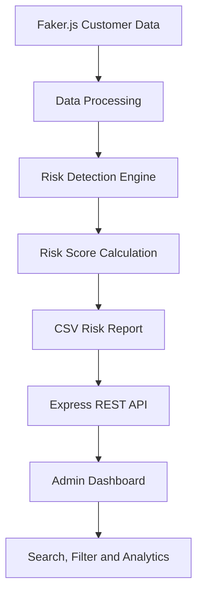

# 🛡️ RiskGuard – E-commerce Fraud & Return Risk Detection System


**RiskGuard** is a Node.js-based risk management system that identifies suspicious e-commerce return and claim patterns. It helps businesses detect potential **Return Abusers, Scammers, and Claim Abusers** through automated risk scoring and a centralized admin dashboard.

> **Note:** All customer profiles used in this project are synthetic European demo data generated with Faker.js. They do not represent real individuals.

---

## ✨ Key Features

- 👥 **Synthetic Customer Data:** Generate 50 realistic European customer profiles.
- 🧠 **Automated Risk Detection:** Identify suspicious return and claim patterns.
- 📊 **Risk Scoring:** Assign risk scores from 0–100.
- 📁 **CSV Reporting:** Generate a structured risk list.
- 🔌 **REST API:** Retrieve customer risk records through Express.js.
- 🖥️ **Admin Dashboard:** View, search, and filter customer risk records.
- 📈 **Risk Analytics:** Display customer statistics and risk categories.

## 🛠️ Tech Stack

| Component | Technology |
|---|---|
| Backend | Node.js, Express.js |
| Frontend | HTML5, Vanilla JavaScript |
| Styling | Tailwind CSS (CDN) |
| Data Generation | Faker.js |
| CSV Processing | csv-parse |
| Data Storage | CSV Files |

---

## 🔄 System Workflow



## 📊 Risk Detection Rules

| Condition | Risk Category | Suggested Status |
|---|---|---|
| Return rate above 70% | `return_abuser` | Review / Blocked |
| 3+ damaged or empty-box claims within 30 days | `scammer` | Review / Blocked |
| 80% or more orders have "not as described" claims | `claim_abuser` | Warning / Review |
| Normal shopping behavior | `none` | Safe |

**Return Rate Formula:**

```text
Return Rate = (Total Returns / Total Orders) × 100
```

Risk scores are calculated using defined rules and measurable customer activity. A high score indicates a need for investigation, not proof of fraud.

---

## 📂 Project Structure

```text
riskguard-fraud-detection/
│
├── data/
│   └── return_abusers_risk_list.csv
│
├── public/
│   └── index.html
│
├── generate-data.js
├── server.js
├── package.json
└── README.md
```

## 🚀 Installation & Setup

### 1. Clone the Repository

```bash
git clone https://github.com/MaryamTariq-1/riskguard-fraud-detection-.git

cd riskguard-fraud-detection-
```

### 2. Install Dependencies

```bash
npm install
```

### 3. Generate Customer Data

```bash
node generate-data.js
```

This generates 50 synthetic European customer profiles and creates the CSV risk report.

### 4. Start the Server

```bash
node server.js
```

### 5. Open the Dashboard

Visit:

```text
http://localhost:3000
```

---

## 🔌 API Endpoint

### Get All Risk Records

| Method | Endpoint | Description |
|---|---|---|
| GET | `/api/risks` | Retrieve all customer risk records |

**Example Response:**

```json
{
  "success": true,
  "total_records": 50,
  "data": [
    {
      "user_id": "USR-1001",
      "full_name": "Hans Mueller",
      "email": "hans.mueller@example.eu",
      "country": "Germany",
      "total_orders": 35,
      "total_returns": 28,
      "return_rate_percent": 80,
      "claim_type": "return_abuser",
      "risk_score": 85,
      "status": "Blocked"
    }
  ]
}
```

---

## 🔐 Data Privacy & GDPR Considerations

- No real customer information is used.
- Customer profiles are synthetically generated using Faker.js.
- Synthetic data supports safe development and testing.
- Real-world deployments should follow GDPR requirements, including lawful data processing, data minimization, access controls, and retention policies.

---

## 👩‍💻 Author

**Maryam Tariq**

- GitHub: [MaryamTariq-1](https://github.com/MaryamTariq-1)
- LinkedIn: [Maryam Tariq](https://www.linkedin.com/in/maryamtariq1/)

---

⭐ **RiskGuard – Smarter Risk Detection for E-commerce Businesses.**