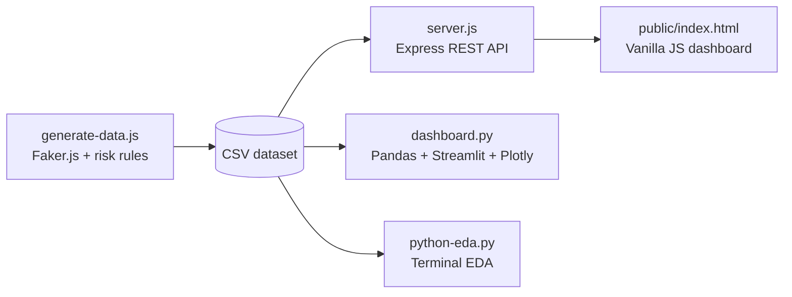

# RiskGuard — E-commerce Fraud & Return Risk Detection System

[](https://nodejs.org/)
[](https://expressjs.com/)
[](https://www.python.org/)
[](https://streamlit.io/)
[](#gdpr-and-synthetic-data)

RiskGuard is a full-stack prototype for exploring how e-commerce teams can identify unusual return and refund-claim patterns. Inspired by risk-management platforms such as Signifyd, it combines a Node.js REST API and browser dashboard with a separate Python analytics dashboard.

> **Scope:** This project demonstrates synthetic-data generation, explainable rule-based flagging, API integration, and dashboard analytics. It is not a production fraud decision system, and its risk scores are not machine-learning probabilities.

## Problem Statement

High return rates and repeated claims can create operational and financial costs for online retailers. RiskGuard generates a small synthetic dataset, applies transparent heuristics to highlight patterns for review, and presents the resulting records in dashboards.

The prototype is intended for development and demonstration. Its generated dataset does not contain event-level order or claim histories, so some named claim categories are represented by return-behavior proxies rather than verified claim evidence.

## Features

- Generate 50 synthetic customer records with Faker.js.
- Calculate each customer's return rate and apply rule-based risk categories, scores, and statuses.
- Write generated records to a CSV file.
- Serve the CSV data as JSON through an Express endpoint.
- Search and status-filter records in a vanilla JavaScript dashboard; KPI cards update to reflect the filtered results.
- Explore filtered metrics and interactive charts in a Streamlit, Pandas, and Plotly dashboard.
- Print basic dataset summaries with a standalone Python EDA script.

## Architecture



The Node.js generator creates the shared CSV artifact. Express serves the static browser application and parses the CSV for `GET /api/risks`. The browser fetches that JSON and renders the table and summary metrics. The Python dashboards read the same CSV directly: Streamlit provides interactive filters and charts, while `python-eda.py` prints basic summaries to the terminal.

This hybrid setup keeps the application API and browser UI in the JavaScript ecosystem while using Python's data-analysis libraries for exploratory analytics. The two dashboards are separate consumers of the generated CSV; the Python dashboard does not call the Express API.

## Tech Stack

| Area | Technologies | Responsibility |
|---|---|---|
| Data generation | Node.js, `@faker-js/faker` | Create synthetic profiles and apply demo risk rules |
| API and static hosting | Express.js | Serve the web application and expose CSV records as JSON |
| CSV parsing | `csv-parse` | Parse generated CSV rows in the API |
| Browser dashboard | HTML5, vanilla JavaScript, Tailwind CSS CDN | Search, status filtering, KPI cards, and risk table |
| Analytics dashboard | Python, Pandas, Streamlit, Plotly | Sidebar filters, metrics, and interactive visualizations |

## Risk Logic and Flagging Rules

The return rate is calculated as:

```text
Return rate (%) = (total returns / total orders) × 100
```

Rules are checked in order. Because the implementation uses an `if`/`else if` chain, a record matching an earlier rule is not evaluated against later rules.

| Priority | Implemented condition | Category | Demo risk score | Demo status |
|---|---|---|---|---|
| 1 | Return rate is greater than 70% | `return_abuser` | Random integer from 75–95 | `Banned` when score > 85; otherwise `Blocked` |
| 2 | At least 3 returns and return rate > 40% | `scammer` proxy | Random integer from 60–88 | `Blocked` when score > 80; otherwise `Review` |
| 3 | Return rate > 50% and at least 2 returns | `claim_abuser` proxy | Random integer from 45–75 | `Review` when score > 65; otherwise `Warning` |
| Default | None of the above | `None` (no flag) | Random integer from 0–30 | `Safe` |

The risk score is randomly assigned within the matching rule's range; it is **not** a probability, calibrated model output, or prediction of confirmed fraud.

The intended business scenarios include repeated damaged/empty-box claims and “not as described” claims. However, the current dataset does not contain individual claim records or claim-type counts. The generator approximates those scenarios with return-count and return-rate conditions; see [Production Improvements & Limitations](#production-improvements--limitations).

## Repository Structure

```text
riskguard-fraud-detection-/
├── data/
│   └── return_abusers_risk_list.csv  # Generated dataset
├── public/
│   └── index.html                   # Browser dashboard
├── dashboard.py                     # Streamlit analytics dashboard
├── generate-data.js                 # Synthetic data and risk-rule generator
├── python-eda.py                    # Terminal-based EDA
├── server.js                        # Express API and static-file server
├── package.json
└── README.md
```

## Setup and Installation

### Node.js API and browser dashboard

Requirements: a supported Node.js installation and npm.

```bash
git clone https://github.com/MaryamTariq-1/riskguard-fraud-detection-.git
cd riskguard-fraud-detection-
npm install
node generate-data.js
node server.js
```

Open [http://localhost:3000](http://localhost:3000) to use the browser dashboard. The API endpoint is [http://localhost:3000/api/risks](http://localhost:3000/api/risks).

The generator overwrites `data/return_abusers_risk_list.csv` with 50 newly generated records each time it runs.

### Python analytics dashboard

Use Python 3 and install the dashboard dependencies in a virtual environment:

```bash
python -m venv .venv
```

Activate the environment, then install packages:

```bash
# Windows PowerShell
.\.venv\Scripts\Activate.ps1

# macOS/Linux (use this instead on those platforms)
source .venv/bin/activate

python -m pip install pandas streamlit plotly
```

Generate the CSV first using the Node.js steps above. Then launch the analytics dashboard:

```bash
streamlit run dashboard.py
```

To print the basic terminal summary instead:

```bash
python python-eda.py
```

## API

| Method | Route | Description |
|---|---|---|
| `GET` | `/api/risks` | Return all records parsed from the generated CSV |

Successful responses have the shape:

```json
{
  "success": true,
  "total_records": 50,
  "data": [
    {
      "user_id": "USR-1001",
      "full_name": "Example Customer",
      "email": "example.customer@example.eu",
      "phone": "+491234567890",
      "country": "Germany",
      "total_orders": 20,
      "total_returns": 15,
      "return_rate_%": 75,
      "claim_type": "return_abuser",
      "risk_score": 85,
      "status": "Blocked",
      "last_incident_date": "2026-10-25",
      "reason_details": "High return rate of 75% exceeding 70% threshold."
    }
  ]
}
```

The sample record above is illustrative; generated values vary between runs.

## GDPR and Synthetic Data

Faker.js is used to create synthetic demonstration records instead of importing real customer data. This reduces privacy risk during development, makes the project reproducible without access to customer databases, and allows the dashboards to be exercised with realistic-shaped records.

Synthetic data use does **not** by itself establish GDPR compliance or guarantee that generated values could never resemble a real person. A production system processing personal data would still need an appropriate lawful basis, a defined purpose, data minimization, access controls, retention limits, security safeguards, and suitable processes for data-subject rights and review of consequential decisions. This project should not be described as legally certified or production GDPR-compliant.

## Production Improvements & Limitations

- **Use event-level claims:** Store timestamped orders, returns, and claim events with claim types and outcomes. Compute rolling 30-day claim counts from those records instead of describing return-rate proxies as verified damaged/empty-box or “not as described” claims.
- **Validate and calibrate decisions:** Evaluate rule outcomes against appropriately labeled historical data, measure false positives and false negatives, and treat risk flags as review signals rather than proof of fraud. The current category scores are random values in rule-specific bands, not ML probabilities.
- **Replace CSV for operational storage:** CSV is convenient for a small demo and shared analysis, but has no transactions, indexes, concurrent-write controls, or efficient filtering and pagination. A production deployment would generally use a database and an explicit schema.
- **Improve API scalability and resilience:** The current API reads and synchronously parses the entire CSV on each request and returns all rows at once. Add validation, pagination, server-side filters, structured errors, tests, and an appropriate data-loading strategy.
- **Strengthen privacy and governance:** Apply least-privilege access, retention and deletion policies, auditability, secure handling of personal data, and human review or appeal paths for high-impact actions.
- **Expand testing and monitoring:** Add tests for rule boundaries, CSV parsing, API responses, dashboard filters, data quality, and changes in false-positive rates.
